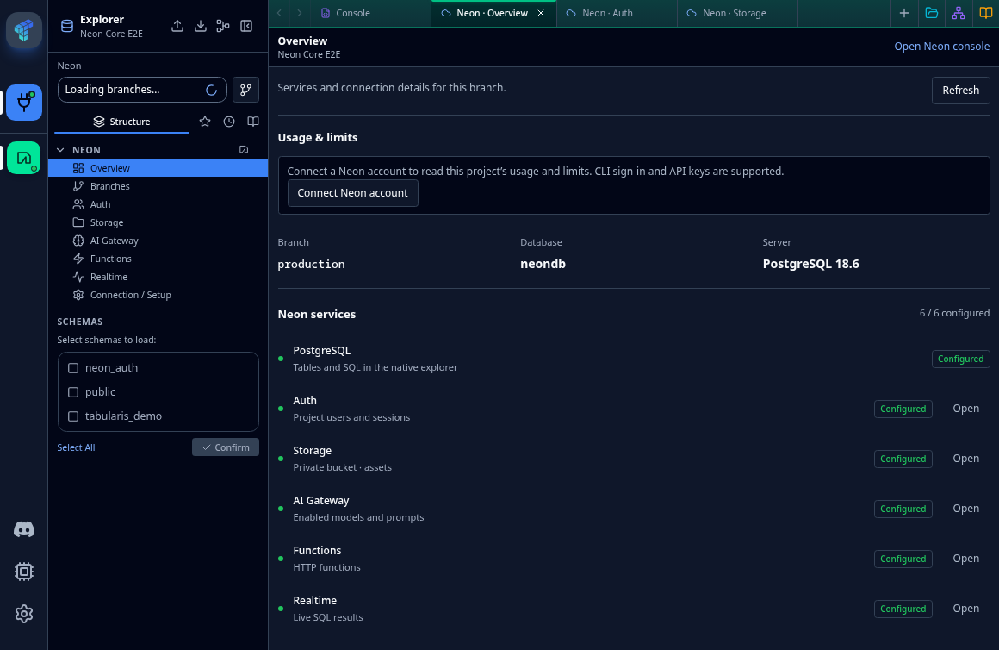
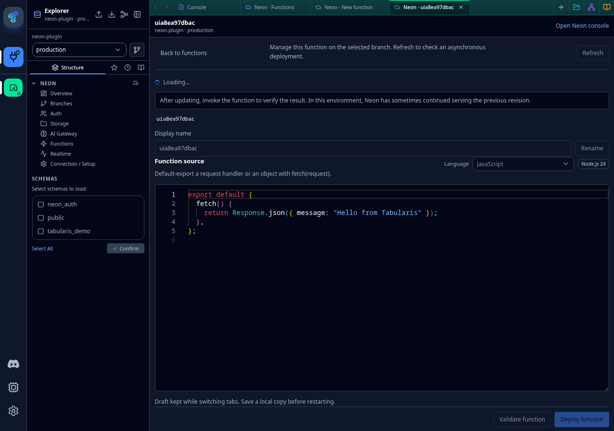
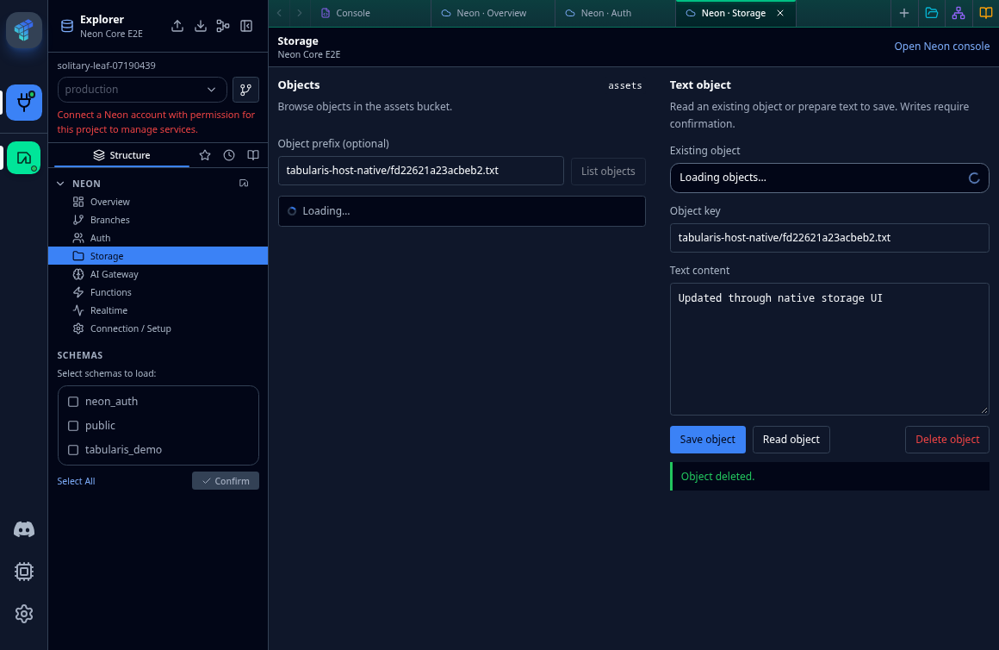
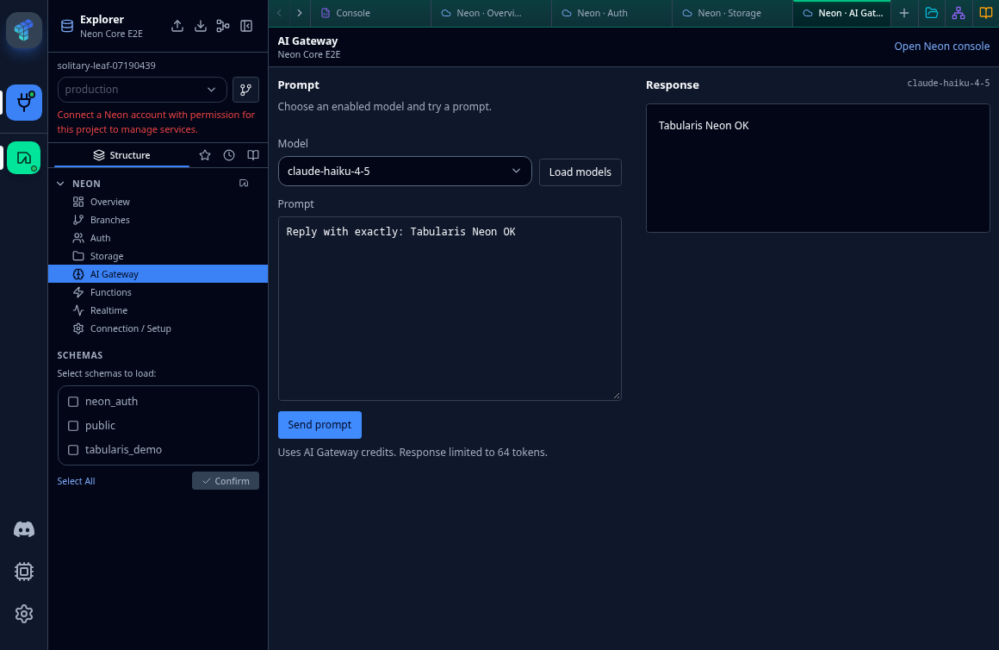

# Neon for Tabularis (preview)

A native Neon workspace for the Tabularis desktop database client: PostgreSQL,
branches, Auth, private text objects, Functions, Realtime and the AI Gateway.

**This is a preview.** It requires the provider-workspace Core changes and plugin
API **0.2.7**. Stock Tabularis 0.31.0 does not include that API. See [Core PR #1445](https://github.com/TabularisDB/tabularis/pull/1445) and
`CORE_INTEGRATION.json` for the required source revision.

**Known live failure:** Neon can report a deployment as completed/active while
GET and POST execute the previous Function code and environment. Independent
SDK/HTTP controls reproduce it. Initial deployments work; verify the endpoint
after every update. The plugin does not delete and recreate existing Functions
to conceal this problem.

## Installation

The published archive currently targets **Linux x64** and requires **Node.js 22+**
on the Tabularis host. It includes its runtime dependencies; Node itself is not
bundled. Other platforms have not been packaged or verified in this release.

Download the ZIP and standalone `.tabularium` from
[GitHub Releases](https://github.com/NewtTheWolf/tabularis-neon-plugin/releases).
Use the compatible Core build, then install the driver using Tabularis's plugin
installer. An ordinary PostgreSQL connection remains available through the
PostgreSQL driver when provider management is not needed.

Choose **Add Connection → Neon**. Reuse an installed Neon CLI 8.15.1+ 8.x profile,
or connect with a Neon account API key. Select organization, project, branch,
database and role. Partner OAuth credentials are not yet configured.

The CLI profile reference is stored in the host secret store; the CLI owns token
refresh. Keys and database passwords are write-only and never returned to the
plugin UI. CLI login runs on the Tabularis host, also in web mode.

## Features and current limits

- **PostgreSQL:** SQL, metadata, CRUD, EXPLAIN, views and routine inspection.
  Table/column DDL controls are disabled. Pagination materializes results.
- **Branches:** list, create from an explicit parent, rename, open/reuse separate
  connections, and confirm deletion with protection for local bindings.
- **Auth:** search/paginate, inspect users, create identities, change user/admin
  roles and confirm deletion. Password reset, invitations and session revocation
  are not implemented.
- **Storage:** list/read/write/delete text objects in the private `assets` bucket.
  Writes require confirmation; arbitrary bucket selection is not implemented.
- **Functions:** Monaco JS/TS syntax and type diagnostics, compile validation,
  initial deployment, rename, environment patches, GET/POST invocation, available
  logs and deletion. Deployment acceptance is not runtime verification.
  Original remote source cannot be downloaded. External packages need CLI bundling.
- **Realtime:** a bounded live SQL snapshot and waiting for a matching value;
  the UI is not a general streaming-subscription manager.
- **AI Gateway:** enabled models and a real completion. The UI's 64-token response
  cap is a prototype limit, not a Neon quota.
- **Usage:** scoped consumption and resource caps when the API provides them.
  Missing invoice totals, remaining budget and service allowances are shown as
  unavailable. Organization spending notifications do not imply enforcement.

Importing discovers enabled services without provisioning or rotating them.
Creating Storage/AI service credentials is an explicit opt-in. Disconnecting the
local account does not delete remote resources or invalidate independent SQL
connections.

## Screenshots

Actual Tabularis integration-test captures with disposable source/text objects
and synthetic AI prompts. No credentials or user lists are included. Loading
indicators and account setup notices belong to the captured preview build.






## Build and test

The vendored public SDK tarball pins the unreleased Core API types; no private
Core source is required to build these UI bundles.

```sh
pnpm install --frozen-lockfile --ignore-scripts
pnpm --dir ui install --frozen-lockfile --ignore-scripts
pnpm build
pnpm test
pnpm --dir ui typecheck
pnpm package
```

Runtime unit tests include manifest-independent SQL behavior, account isolation,
branch safeguards, environment validation, usage calculations and archive
replacement/credential exclusion. Full live web/desktop integration and legacy
Core regression tests live in the linked Tabularis Core branch. Live tests create
and remove disposable resources and can incur small provider charges.

Packaging creates a fresh archive with runtime code, dependencies, UI bundles,
locales, manifest, documentation, icon and license. It excludes `.env`, `.neon`,
test captures and the source checkout. Version tags must match `.tabularium`.
Publish `.tabularium` as a standalone release asset as well as inside the ZIP.

## License and support

Apache-2.0; see [LICENSE](LICENSE) and [NOTICE](NOTICE). Derived from Tabularis and
its public plugin SDK. Neon names and marks belong to their respective owners.

[Report a plugin issue](https://github.com/NewtTheWolf/tabularis-neon-plugin/issues).
