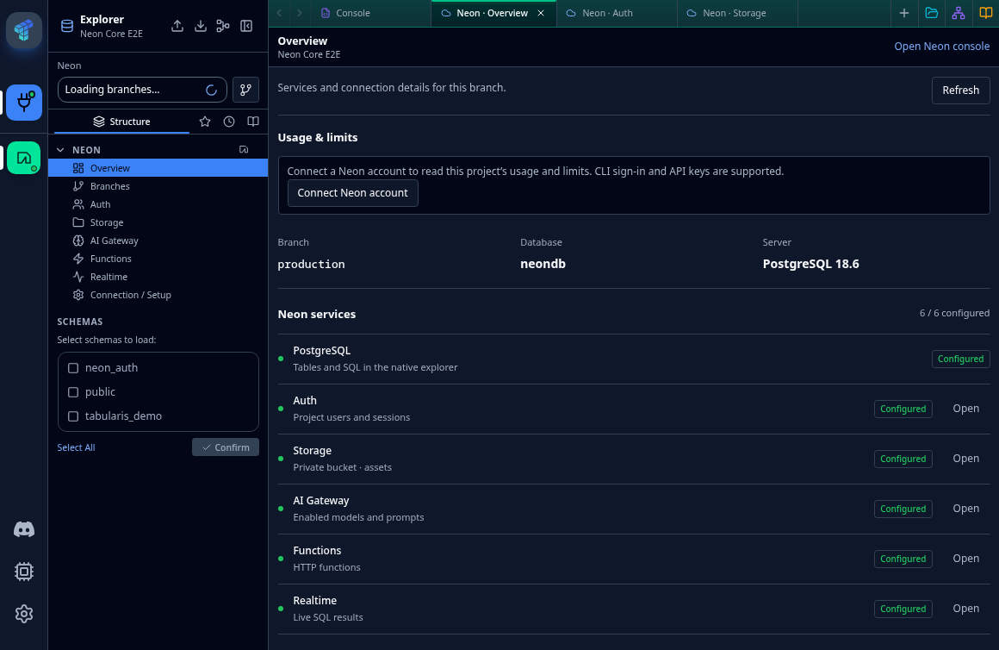
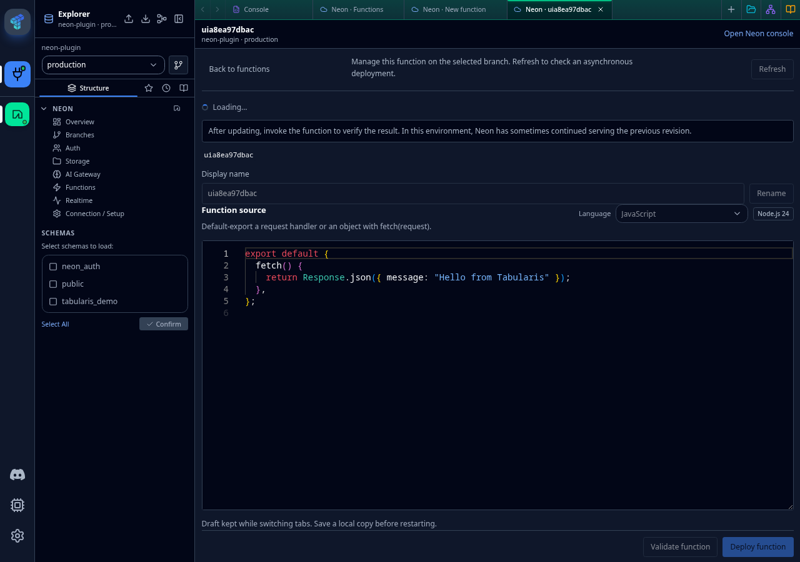
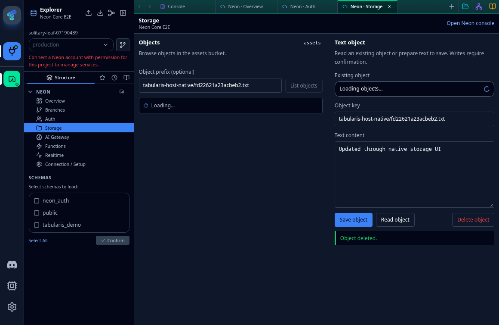
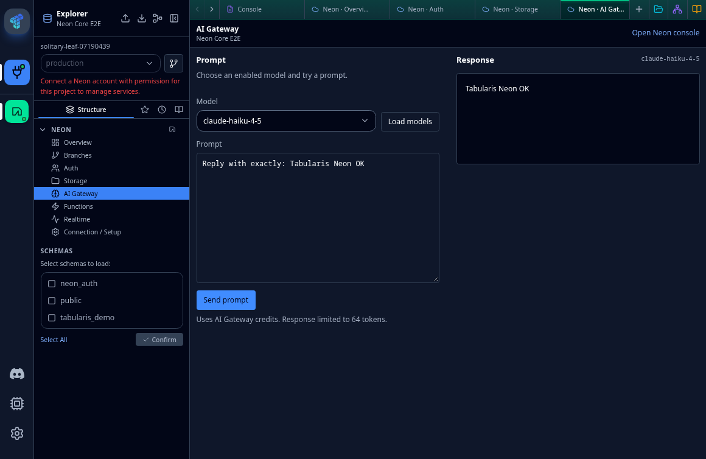

# Neon for Tabularis (preview)

A native Neon workspace for the Tabularis desktop database client: PostgreSQL,
branches, Auth, private text objects, Functions, Realtime and the AI Gateway.

**This is a preview.** It requires the provider-workspace Core changes and plugin
sandbox API **0.4.1**, plus acceptance of the `cloud` package kind. Stock releases without the provider bridge do not include that API. See [Core PR #1445](https://github.com/TabularisDB/tabularis/pull/1445) and
`CORE_INTEGRATION.json` for the required source revision.

**Observed activation delay:** Live SDK and independent HTTP tests confirmed that
Neon can report a new deployment as completed/active while requests still execute
the previous code and environment. In the tested scope, the new revision became
active after roughly two minutes. Deployment acceptance remains separate from
runtime verification: use an explicit safe test endpoint and a unique nonsecret
response marker, then retry after propagation if necessary. The plugin does not
delete and recreate existing Functions to conceal this delay.

The registry classifies this package as **Cloud**. It retains the executable
JSON-RPC database driver contract for SQL and metadata operations. The supporting
Core build accepts `kind: cloud`; older hosts reject that package kind.

## Installation

The published archive currently targets **Linux x64** and requires **Node.js 22+**
on the Tabularis host. It includes its runtime dependencies; Node itself is not
bundled. Other platforms have not been packaged or verified in this release.

Download the ZIP and standalone `.tabularium` from
[GitHub Releases](https://github.com/TabularisDB/neon-plugin/releases).
Use the compatible Core build, then install the driver using Tabularis's plugin
installer. An ordinary PostgreSQL connection remains available through the
PostgreSQL driver when provider management is not needed.

Choose **Add Connection → Neon**. Reuse an installed Neon CLI 8.15.1+ 8.x profile,
or connect with a Neon account API key. Select organization, project, branch,
database and role. Partner OAuth credentials are not yet configured.

The CLI profile reference is stored in the host secret store; the CLI owns token
refresh. Keys and database passwords are write-only and never returned to the
plugin UI. CLI login runs on the Tabularis host, also in web mode.

## Features and current limits

- **PostgreSQL:** SQL, metadata, CRUD, EXPLAIN, views and routine inspection.
  Table/column DDL controls are disabled. Single-query pagination uses a server
  cursor; batches retain their transaction semantics with bounded streaming.
  Results retain at most 10,000 rows and 8 MiB; oversized explicit pages fail
  clearly so exports cannot silently skip rows. Batch streaming can still transfer
  the full result from the database.
- **Branches:** list, create from an explicit parent, rename, open/reuse separate
  connections, and confirm deletion with protection for local bindings.
- **Auth:** search/paginate, inspect users, create identities, change user/admin
  roles and confirm deletion. Password reset, invitations and session revocation
  are not implemented.
- **Storage:** list/read/write/delete text objects in the private `assets` bucket.
  Object lists use continuation tokens and bounded next/previous pages. Writes
  require confirmation; arbitrary bucket selection is not implemented.
- **Functions:** Monaco JS/TS syntax and type diagnostics, compile validation,
  initial deployment, rename, environment patches, GET/POST invocation, available
  logs and deletion. Explicit runtime checks compare a nonsecret response marker
  with the selected deployment and never equate deployment acceptance with activation.
  Original remote source cannot be downloaded. External packages need CLI bundling.
- **Realtime:** a bounded live SQL snapshot and waiting for a matching value;
  the UI is not a general streaming-subscription manager.
- **AI Gateway:** enabled models and a real completion. The UI's 64-token response
  cap is a prototype limit, not a Neon quota.
- **Usage:** scoped consumption and resource caps when the API provides them.
  Missing invoice totals, remaining budget and service allowances are shown as
  unavailable. Organization spending notifications do not imply enforcement.

Importing discovers enabled services without provisioning or rotating them.
Creating Storage/AI service credentials is an explicit opt-in. Disconnecting the
local account does not delete remote resources or invalidate independent SQL
connections.

## Screenshots

Actual Tabularis integration-test captures with disposable source/text objects
and synthetic AI prompts. No credentials or user lists are included. Loading
indicators and account setup notices belong to the captured preview build.






## Build and test

The vendored public SDK tarball pins the unreleased Core API types; no private
Core source is required to build these UI bundles.

```sh
pnpm install --frozen-lockfile --ignore-scripts
pnpm --dir ui install --frozen-lockfile --ignore-scripts
pnpm build
pnpm test
pnpm --dir ui typecheck
pnpm package
```

The offline sandbox smoke uses the real packaged UI, a built Core server and an
isolated empty home directory. It never links an account or accesses Neon:

```sh
TABULARIS_CORE_ROOT=/path/to/built/tabularis pnpm test:sandbox
```

Install the Core checkout's Playwright Chromium first. Set `CHROME_PATH` only when
using a separately installed Chromium. Test evidence is written under `artifacts/`.

Runtime unit tests include manifest-independent SQL behavior, account isolation,
branch safeguards, environment validation, usage calculations and archive
replacement/credential exclusion. The host-integration tests live in this plugin repository and accept
`TABULARIS_CORE_ROOT` for a compatible Core checkout. Core itself contains only
generic provider APIs and neutral regression fixtures. Live tests create
and remove disposable resources and can incur small provider charges.

Packaging creates a fresh archive with runtime code, dependencies, UI bundles,
locales, manifest, documentation, icon and license. It excludes `.env`, `.neon`,
test captures and the source checkout. Version tags must match `.tabularium`.
Publish `.tabularium` as a standalone release asset as well as inside the ZIP.

## License and support

Apache-2.0; see [LICENSE](LICENSE) and [NOTICE](NOTICE). Derived from Tabularis and
its public plugin SDK. Neon names and marks belong to their respective owners.

[Report a plugin issue](https://github.com/TabularisDB/neon-plugin/issues).

## Host integration tests

Runtime builds are independent of Core source. UI host-component and full web
integration tests use a compatible Core checkout for the renderer and binary:

```sh
# Install the compatible Core checkout first; do not copy this plugin into it.
TABULARIS_CORE_ROOT=/path/to/tabularis pnpm --dir ui test:host
TABULARIS_CORE_ROOT=/path/to/tabularis \
NEON_ACCOUNT_TEST_AUTH_MODE=cli \
NEON_ACCOUNT_TEST_PROJECT_ID=your-test-project \
NEON_ACCOUNT_TEST_BRANCH_ID=br-your-disposable-branch \
NEON_ACCOUNT_TEST_EXPECT_BRANCH_NAME=tabularis-pr1445-live-your-suffix \
NEON_ACCOUNT_TEST_CLI_PROFILE=DEFAULT \
NEON_ACCOUNT_TEST_CLI_CONFIG_DIR=/path/to/neon-config \
node tests/account-host-e2e.mjs
```

Live tests require your explicit Neon account/service configuration and may
create disposable resources. Never run them against an unrelated account. The web
regression is read-only by default. `NEON_ACCOUNT_TEST_FUNCTION_WRITES=1` enables
its own randomly named disposable Function workflow on the explicitly selected
test branch; it never invokes, replaces or deletes other Functions.

## Running with tabularis web

The same packaged plugin runs in desktop and web. Install Node.js 22+ and the
plugin on the server. CLI sign-in belongs to that server; select its profile
explicitly, with `NEON_CONFIG_DIR` pointing to the server-side CLI configuration
when needed. The browser never receives the stored account token or SQL password.

Password-authenticated deployments require `--allow-high-risk` for provider
account and management operations, which deliberately retain administrator-only
authorization. On headless hosts configure `TABULARIS_SECRET_STORE=file`, a
persistent `TABULARIS_SECRET_STORE_PATH` and a stable `TABULARIS_SECRET_KEY`. Keep
the encryption key securely across restarts; do not generate a new one on every
launch. The local bootstrap mode already grants the launching owner admin access.

The live web regression uses its own password, encrypted secret store, isolated
application directories and explicitly selected disposable Neon branch. It does
not use production defaults or force clicks through clipped UI.

## Disposable Function activation diagnostic

`tests/activation-diagnostic.mjs` requires an explicit disposable project and branch,
plus `NEON_MANAGEMENT_TEST_ALLOW_MUTATIONS=1`, either `NEON_MANAGEMENT_TEST_API_KEY`
or an explicitly selected `NEON_MANAGEMENT_TEST_CLI_PROFILE`,
`NEON_MANAGEMENT_TEST_PROJECT_ID` and `NEON_MANAGEMENT_TEST_BRANCH_ID`. It creates
one temporary Function, tests initial code/environment, a combined update and an
environment-only update through GET and POST, and deletes the temporary Function
in cleanup. It never implicitly selects a saved profile or credentials. A named CLI profile
is reused only when explicitly requested. Each phase waits up to 180 seconds for
the expected runtime response; `NEON_MANAGEMENT_TEST_PROPAGATION_MS` can configure
a bounded window up to 300 seconds. Do not use
production secrets as expected response markers. Run only against your chosen
disposable scope; the diagnostic can incur provider charges.
